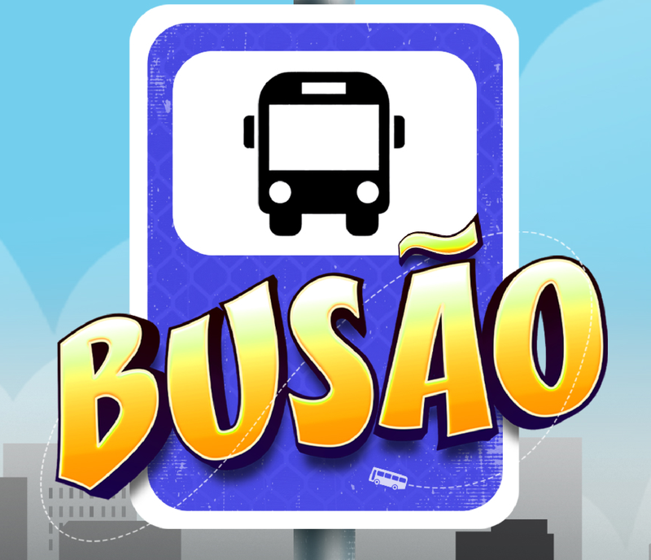

<div align="center">



# Busão — Calculador de Pontuação & Companion App
**Aplicativo Web Progressivo (PWA) de alta fidelidade para cálculo automatizado de pontuação, visão computacional OCR e catálogo de cartas do jogo de tabuleiro *Busão*.**

[](https://github.com/maikonfcosta/app-busao)
[](https://github.com/maikonfcosta/app-busao)
[](https://jestjs.io/)
[](https://eslint.org/)
[](https://www.w3.org/WAI/standards-guidelines/wcag/)
[](https://developer.mozilla.org/pt-BR/docs/Web/Progressive_web_apps)
[](LICENSE)

*“Prepare-se para uma viagem estratégica, onde manter o caos sob controle é só o começo!”*

</div>

---

## 🚌 Sobre o Jogo

**Busão** é um jogo nacional de tabuleiro criado por **Alison Fabrizi**, combinando estratégia, posicionamento de malha e controle de caos urbano para 2 a 6 jogadores.

No volante de uma linha municipal de ônibus lotado, os jogadores devem gerenciar o embarque e desembarque de passageiros com personalidades excêntricas, exigências de conforto e rivalidades a bordo. Ao término da viagem, a pontuação final exige consolidar:
- Habilidades individuais e restrições de cada um dos 12 assentos do ônibus;
- Bônus do motorista ativo e sinergias de até 3 melhorias mecânicas instaladas;
- Penalidades severas por superlotação e cartas não jogadas retidas na mão;
- Efeitos complexos de adjacência (ortogonais e diagonais) e cartas de expansão.

---

## 🎯 Proposta do Companion App

O **Calculador Busão** elimina a sobrecarga cognitiva e as disputas de regras ao final da partida, oferecendo uma esteira digital fluida, reativa e matematicamente precisa. 

Projetado sob a filosofia de design **Urban Transit Tabletop**, o app opera **100% offline no navegador** (Progressive Web App com Service Worker) e incorpora visão computacional local (Tesseract OCR) para ler o tabuleiro diretamente pela câmera do celular sem enviar nenhuma foto para servidores externos.

---

## ✨ Funcionalidades Principais

### 1. Cabine de Pontuação em Tempo Real (Engine Puro)
- **Cálculo Reativo Automatizado:** Motor matemático isolado (`GameLogic.js`) que processa instantaneamente bônus, sinergias e penalidades a cada mudança.
- **Detalhamento KPI Instantâneo:** Quebra analítica em cartões táteis divididos por Passageiros, Motorista, Melhorias, Perrengues, Rotas Diárias e Desconto de Mão.
- **Explicação Auditável por Assento:** Relatório descritivo linha a linha indicando exatamente a fórmula aplicada a cada passageiro e o motivo de eventuais bloqueios.

### 2. Playmat Tátil & Radar de Adjacência
- **Visualizador do Ônibus:** Renderização gráfica do veículo com cabine do motorista, para-brisa chanfrado e grade 2 × 6 de assentos.
- **Radar de Adjacência Dinâmico:** Passar o mouse ou focar qualquer poltrona ilumina instantaneamente no ônibus visual todos os assentos vizinhos válidos (ortogonais e diagonais).
- **Troca Rápida de Assentos (Swap):** Permuta de passageiros entre dois assentos com 2 cliques ou toques (`⇄`), recalculando automaticamente as adjacências.
- **Cards de Assento Ricos:** Cada poltrona exibe badge da pontuação líquida calculada ao vivo (`+X pts`, `0 pts` ou `⚠️ Inativo`), tags micro e botão de remoção rápida (`✕`).
- **Bloqueio Canônico do Wilson:** Alerta visual dedicado `🔒 Wilson (2 lugares)` quando a poltrona oposta na coluna está ocupada pelo Wilson.

### 3. Modal Picker Inteligente & Catálogo Interativo
- **Seletor Vertical Rico:** Cards com nome, tags coloridas, descrição do efeito e alerta preventivo de regras (`🚫 ...`) para telas touch.
- **Catálogo Geral com Filtros Cruzados:** Busca por texto livre (nome, efeito, tags) combinada com filtros rápidos por Faixa Etária, Temperamento, Comportamento e Expansão.
- **Auto-Save da Partida:** Persistência automática no `localStorage` protegendo o progresso da rodada contra recargas acidentais de página.

### 4. Scanner por Câmera (Visão Computacional Local)
- **Wizard Guiado:** Passo a passo com pré-visualização de enquadramento (Rota Diária → Perrengue → Melhorias → Motorista → Passageiros).
- **OCR 100% Client-Side:** Processamento local via WebAssembly com `Tesseract.js`.
- **Fuzzy Matching com Levenshtein:** Tolerância a imperfeições de iluminação, reflexos no sleeve e pequenas rotações da carta.

### 5. Ranking Local com Pódio & Compartilhamento
- **Placar Histórico com Medalhas:** Pódio automático (`🥇`, `🥈`, `🥉`) com persistência no navegador e remoção de registros individuais.
- **Compartilhamento Nativo (Web Share API):** Envio direto do comprovante de vitória para WhatsApp, Telegram ou download de imagem PNG via `html2canvas`.

---

## 📦 Expansões Suportadas

O aplicativo inclui suporte integral a todas as expansões oficiais do jogo:

| Expansão | Ícone | Mecânica Implementada |
| :--- | :---: | :--- |
| **Cobradores** | 💶 | 1 cobrador por ônibus; concede +2 por cada passageiro com a característica cobrada. |
| **Os Apaixonados** | ❤️ | Podem ser duplicados; quando 2+ estão adjacentes, dobram a soma dos pontos base do grupo. |
| **Estou no Busão** | 👍 | Passageiros especiais com habilidades assimétricas e exigências exclusivas. |
| **Lendas Urbanas** | 👻 | Personagens místicos com efeitos de pontuação profunda e regras sobrenaturais. |
| **Grupo de Pagode** | 🎵 | 5 integrantes específicos; concede **+50 pontos extras** ao reunir o conjunto completo a bordo. |
| **Rotas Diárias** | 🚌 | Metas de posicionamento por fileira com bonificação fixa adicional. |
| **Perrengues** | 🚨 | Eventos desafiadores e imprevistos urbanos que afetam o cálculo geral. |

---

## ♿ Acessibilidade & Padrões WCAG 2.2 (Nível AA)

A aplicação foi rigorosamente auditada e refinada para conformidade com as diretrizes internacionais de acessibilidade digital:

- **Contraste Dual-Mode (>= 4.5:1 / 7:1):**
  - **Dark Mode (*Midnight Terminal*):** Superfícies `#070b16` e `#0d1424` com texto `#f1f5f9` e texto atenuado `#94a3b8` (5.8:1).
  - **Light Mode (*Daylight Station*):** Superfícies `#ffffff` e `#f1f5f9` com texto `#0f172a`, atenuado `#334155` (7.1:1) e badges em tons pastel legíveis.
- **Navegação Completa por Teclado:** Cards `.seat` e itens do picker operam com `role="button"`, `tabindex="0"`, acionamento por `Enter`/`Space` e cancelamento de swap por `Escape`.
- **Foco Acessível Visível:** Contornos `:focus-visible` com offset em todos os elementos interativos.
- **Target Size Acessível (SC 2.5.8 >= 24px):** Botões de ação (`⇄` e `✕`) ampliados para 28×28px no desktop e 30×30px no mobile.
- **Regiões Vivas (ARIA Live):** Alertas de pontuação (`#totalScore`) e avisos de regras (`#warnings`) com `aria-live="polite"`.
- **Prevenção Vestibular:** Animações e transições suprimidas sob `prefers-reduced-motion: reduce`.

---

## 🏗️ Arquitetura de Software

```
app-busao/
├── assets/
│   └── img/
│       ├── logo.png             # Logotipo oficial extraído do manual em alta resolução
│       ├── apple-touch-icon.png # Ícone para dispositivos iOS (180x180)
│       ├── icon-192.png         # Ícone PWA (192x192)
│       ├── icon-512.png         # Ícone PWA (512x512)
│       └── favicon-64.png       # Ícone de alta definição (64x64)
├── css/
│   └── style.css                # Design System Urban Transit Tabletop & tokens CSS
├── js/
│   ├── script.js                # Base de dados oficial de cartas, expansões e regras
│   ├── GameLogic.js             # Motor matemático desacoplado de regras e pontuação
│   └── main.js                  # Orquestrador de UI, eventos, renderização e auto-save
├── src/
│   ├── vision/
│   │   ├── CameraHandler.js     # Gerenciamento de WebRTC, captura e OCR
│   │   ├── cardDefinitions.js   # Zonas de foco e enquadramento do scanner
│   │   └── masterCardList.js    # Dicionário unificado de normalização de strings
│   └── utils/
│       └── stringMatcher.js     # Algoritmo Levenshtein com janela deslizante
├── tests/
│   └── GameLogic.test.js        # Suíte Jest cobrindo 100% das regras críticas
├── documentos/
│   ├── Manual 5.0 reduzido.pdf  # Manual e livro de regras oficial
│   └── Listas de cartas com efeitos e pontuação.pdf
├── favicon.ico                  # Favicon multi-camada (16x16, 32x32, 48x48)
├── favicon.png                  # Favicon PNG (32x32)
├── manifest.json                # Manifesto PWA com suporte a instalação offline
├── sw.js                        # Service Worker com estratégia Cache-First
├── index.html                   # Casca da aplicação e estrutura de componentes
├── package.json                 # Scripts de teste, linting e dependências
└── README.md                    # Documentação técnica do projeto
```

---

## 🚀 Como Executar Localmente

### Pré-requisitos
- **Node.js** (v18 ou superior)
- **NPM** (v9 ou superior)
- Navegador moderno (Chrome, Edge, Firefox ou Safari)

### 1. Clonar e Instalar
```bash
git clone https://github.com/maikonfcosta/app-busao.git
cd app-busao
npm install
```

### 2. Executar a Suíte de Testes
```bash
# Executa os 11 testes unitários com Jest
npm test
```

### 3. Verificar Qualidade de Código (Linting)
```bash
# Executa o ESLint garantindo conformidade total
npm run lint
```

### 4. Iniciar Servidor de Desenvolvimento Local
```bash
# Inicia servidor HTTP local na porta 3000
npm start
```
Abra o navegador em `http://localhost:3000`.

---

## 🧪 Qualidade & Cobertura de Testes

A suíte de testes unitários (`tests/GameLogic.test.js`) valida exaustivamente os cenários mais complexos da lógica do jogo:

```text
PASS tests/GameLogic.test.js
  GameLogic
    ✓ should calculate empty bus correctly
    ✓ should calculate penalty for hand cards without Isabel
    ✓ should eliminate hand penalty when Isabel is active
    ✓ should calculate driver bonus correctly
    Cycle detection in isActiveAt (Achado #1)
      ✓ should not throw Maximum Call Stack Size Exceeded when mutually requiring cards are evaluated
    Expansão Grupo de Pagode (Achados #4 e #11)
      ✓ should grant +50 bonus only when all 5 distinct pagode members are present and expansion is active
    Motorista Mateus com Vovó Michel e Dona Fausta (Achado #8)
      ✓ should double driver bonus with Vovó Michel and nullify improvements with Dona Fausta
    Wilson e Santiago (Achados #1, #7, #11)
      ✓ should treat Wilson as occupying both seats in its column for countAdjEmpty and Santiago
    Rotas Diárias e Expansões
      ✓ should score daily route for matching passengers in designated row
    Radar de Adjacência e Swap de Assentos (V2 Evolution)
      ✓ should compute exact neighbor coordinates used by the adjacency radar
      ✓ should recalculate adjacency-dependent points accurately when two seats are swapped

Test Suites: 1 passed, 1 total
Tests:       11 passed, 11 total
Snapshots:   0 total
Time:        0.498 s
```

---

## 📄 Licença

Este projeto é distribuído sob a licença **MIT**. Consulte o arquivo [LICENSE](LICENSE) para obter mais informações.

---

<div align="center">
  <sub>Desenvolvido com café, paixão por board games e foco em engenharia de excelência. 🚌🎲</sub>
</div>
